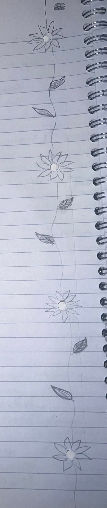

This is a **draft**: it shows up while you run `npm run dev`, but not on the live site. Change `draft: true` to `draft: false` (or delete the line) when it's ready.

My notebook is where both halves of me live. One side of the page has meeting notes, arrows and question marks. The other side has flowers.

## Why the flowers?

At some point I started drawing a flower around every punched hole and joining them up with vines, and I haven't stopped since.

## What I'll write about

- things I'm building and learning at work, the tech side
- life, and whatever I can't stop thinking about
- doodles, obviously

> Every hole gets a different flower.
